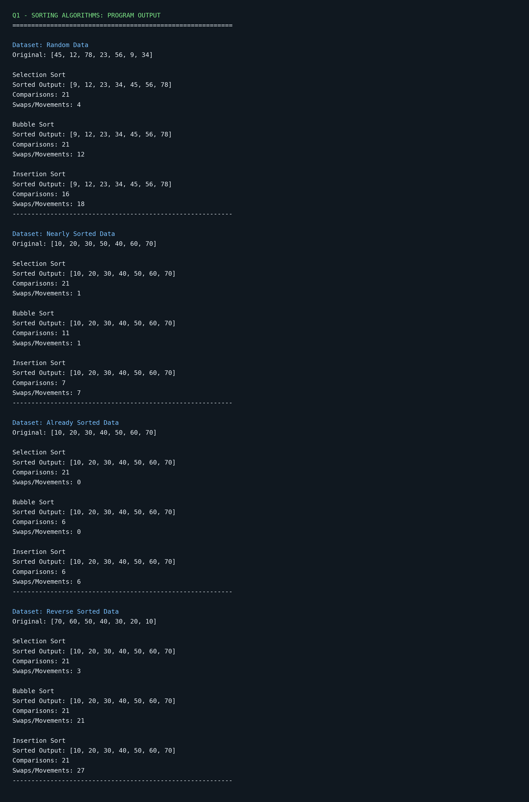

# Q1 – Sorting Algorithms: Output and Analysis

## 1. Introduction

This section presents the execution output of three sorting algorithms:

1. Selection Sort
2. Bubble Sort
3. Insertion Sort

The algorithms were tested using four different input arrangements to compare their performance.

## 2. Test Cases

### Test Case 1: Random Data

Input:
`[45, 12, 78, 23, 56, 9, 34]`

### Test Case 2: Nearly Sorted Data

Input:
`[10, 20, 30, 50, 40, 60, 70]`

### Test Case 3: Already Sorted Data

Input:
`[10, 20, 30, 40, 50, 60, 70]`

### Test Case 4: Reverse Sorted Data

Input:
`[70, 60, 50, 40, 30, 20, 10]`

## 3. Program Execution Output

The following image shows the calculated sorted arrays, comparison counts, and swaps or movements for all three algorithms.

## 4. Experimental Results

### Random Data

| Algorithm | Comparisons | Swaps/Movements |
|---|---:|---:|
| Selection Sort | 21 | 4 |
| Bubble Sort | 21 | 12 |
| Insertion Sort | 16 | 18 |

### Nearly Sorted Data

| Algorithm | Comparisons | Swaps/Movements |
|---|---:|---:|
| Selection Sort | 21 | 1 |
| Bubble Sort | 11 | 1 |
| Insertion Sort | 7 | 7 |

### Already Sorted Data

| Algorithm | Comparisons | Swaps/Movements |
|---|---:|---:|
| Selection Sort | 21 | 0 |
| Bubble Sort | 6 | 0 |
| Insertion Sort | 6 | 6 |

### Reverse Sorted Data

| Algorithm | Comparisons | Swaps/Movements |
|---|---:|---:|
| Selection Sort | 21 | 3 |
| Bubble Sort | 21 | 21 |
| Insertion Sort | 21 | 27 |

## 5. Observations

1. Selection Sort performs 21 comparisons for every seven-element dataset.
2. Bubble Sort performs fewer comparisons on already sorted and nearly sorted data because of early termination.
3. Insertion Sort performs fewer comparisons on nearly sorted data.
4. Reverse sorted input causes more movements in Insertion Sort.
5. All three algorithms produce the same correctly sorted output.

## 6. Conclusion

The experiment demonstrates that input arrangement affects the practical performance of sorting algorithms.

Insertion Sort is suitable for small and nearly sorted datasets. Bubble Sort with early termination also performs efficiently on already sorted data. Selection Sort has a predictable comparison count but does not benefit significantly from an already sorted input.

For an e-commerce order-processing system where approximately 95% of existing orders are already correctly ordered, Insertion Sort is a suitable choice among the three algorithms, subject to validation on the actual workload.

